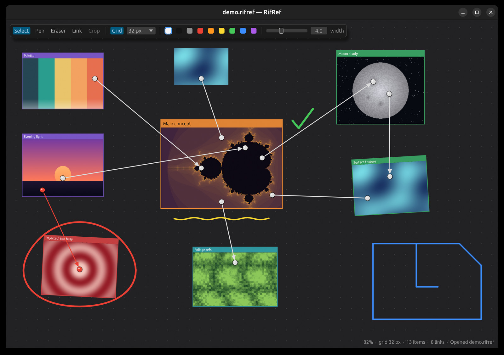
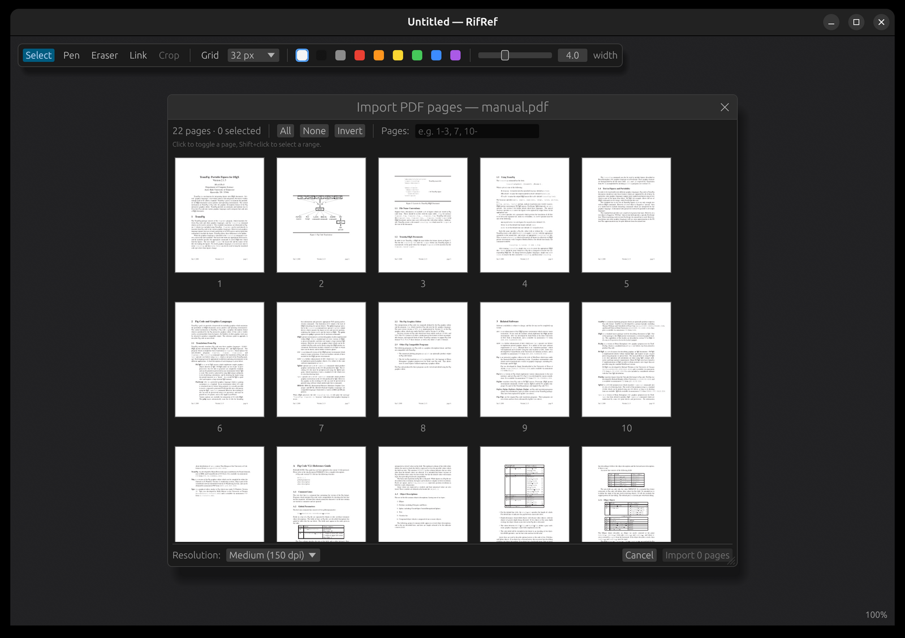

# RifRef

A reference board in the spirit of [PureRef](https://www.pureref.com/), written in Rust with
[egui](https://github.com/emilk/egui). Drop images and PDF pages onto an infinite canvas, arrange
them, sketch over them, and connect them with titled cards and links like an investigation board.



## Features

- **Infinite canvas.** Pan, zoom towards the cursor, and fit everything or just the selection.
- **Images from anywhere.** Drag and drop files, paste from the clipboard (image data or copied
  files), or import with Ctrl+I. Supported formats are PNG, JPEG, GIF, WebP, BMP, TIFF, ICO and
  TGA. Photos honour their EXIF orientation.
- **PDF pages.** Opening a PDF shows a page picker with thumbnails. Choose pages by clicking,
  Shift+clicking a range, or typing ranges like `1-3, 7, 10-`, and pick a render resolution
  (72–300 dpi). Rendering uses [hayro](https://github.com/LaurenzV/hayro), a pure-Rust renderer, so
  there are no system libraries to install.
- **Transform.** Move, scale and rotate (Shift snaps to 15°), flip, reset, bring to front or send
  to back. Ctrl+P packs the selection into a tidy block, and "normalize" gives the selected images
  the same height.
- **Crop like Word.** Press C, then drag the edge or corner handles, or drag inside the frame to
  slide the picture. Enter applies the crop and Esc cancels. Crops are non-destructive.
- **Sketching.**
  - The pen draws strokes that always sit above images.
  - When you lift the pen, the stroke is fitted with smooth curves, which fills the gaps left by
    sparse mouse sampling. Smoothing strength is adjustable.
  - Stroke width is in board pixels, so strokes stay in proportion to the images at any zoom.
  - The eraser splits strokes where it passes.
- **Titles and labels.** Give an image a caption bar (T, F2, or double-click the bar) and a label
  colour to group related cards; the colour square on the bar opens the palette. The bar goes on whichever edge is on top when you first add the
  title, then stays on that edge through rotation and flips, with the text never mirrored.
- **Pinned links.** With the Link tool (L), drag from a spot on one item to a spot on another to
  stretch a string between two pins.
  - Pins stick to that spot of the picture through moving, scaling, rotating, flipping and
    cropping.
  - Drag a pin to re-pin it somewhere else, including onto a different item.
  - Links can have an arrowhead, and can be recoloured, reversed or deleted.
- **Grid and snapping, KiCad style.**
  - The dot grid's spacing is adjustable from presets (2–500 px) or a custom value; N / Shift+N
    step through the presets.
  - Holding Shift snaps moves, scale handles and crop edges to the grid.
  - With Shift, the pen draws 0°/45°/90° segments between grid points. The last segment stays
    "live", so you can change direction mid-stroke.
- **Boards.**
  - Everything is saved in a single `.rifref` file, a JSON document with the images embedded.
  - The last board reopens on start, and unsaved changes are guarded.
  - Undo and redo cover every edit.
- Always-on-top mode, a hideable toolbar, and four background colours.



## Building

You need a recent stable Rust toolchain (edition 2021).

```sh
cargo build --release
./target/release/rifref                 # reopens the last board
./target/release/rifref board.rifref    # open a board
./target/release/rifref photo.jpg       # or start with an image or PDF
```

On Linux, the window needs the usual X11/Wayland libraries that eframe uses. The open/save dialogs
go through the XDG desktop portal.

Running the tests:

```sh
cargo test
```

## Shortcuts

Press **F1** in the app to see the same list.

| Action | Keys |
| --- | --- |
| Pan | Middle or right drag, or Space + drag |
| Zoom | Scroll wheel, Ctrl + / −, Ctrl+0 for 100% |
| Fit all / selection | F, or double-click empty space |
| Select tool | S or V |
| Pen / Eraser | B / E (`[` and `]` change the size) |
| Link tool | L, then drag from a spot on one item to a spot on another |
| Move a pin | Drag it to another spot or onto another item |
| Select | Click, Shift+click, or drag a box |
| Scale | Drag a corner handle |
| Rotate | Drag just outside a corner (Shift snaps to 15°) |
| Paste / Copy / Cut | Ctrl+V / Ctrl+C / Ctrl+X |
| Duplicate / Delete | Ctrl+D / Del |
| Crop image | C, drag the handles; Enter applies, Esc cancels |
| Title an image | T or F2, or double-click its title bar |
| Label colour | Click the colour square on a selected or hovered title bar |
| Link direction and arrowheads | Right-click menu |
| Flip | H horizontal, Shift+H vertical |
| Reset transform | Ctrl+T |
| Arrange | Ctrl+P |
| Bring to front / send to back | PgUp / PgDn |
| Grid | G to show, N / Shift+N to change spacing, hold Shift while dragging to snap |
| Undo / Redo | Ctrl+Z / Ctrl+Shift+Z (or Ctrl+Y) |
| New / Open / Save / Save as | Ctrl+N / Ctrl+O / Ctrl+S / Ctrl+Shift+S |
| Import images or PDF pages | Ctrl+I, or drag and drop |
| Always on top | Ctrl+Shift+T |
| Toolbar | Tab |

## File format

A `.rifref` board is a JSON file with the following contents:

- the background colour, grid settings and camera position;
- every image, stored once as base64 in its original encoded format (crops don't re-encode it);
- the items, which are images or strokes, each with its position, scale, rotation, flips, crop,
  title and label colour;
- the links, which refer to items by their index and store each pin's position (in source pixels
  for images, so crops don't move it).

Fields added in newer versions are optional, so older boards keep opening, including `.refb`
files from before the rename.

## Project layout

| File | Contents |
| --- | --- |
| `src/app.rs` | Application state, input, tools, drawing and UI |
| `src/item.rs` | Board items, links and their geometry (hit testing, crop maths, link endpoints) |
| `src/smooth.rs` | Stroke smoothing (curve fitting) and the grid pen (45° snapping) |
| `src/pdf.rs` | PDF rendering and the page-picker dialog |
| `src/loader.rs` | Background decoding of images, clipboard data and boards |
| `src/scene.rs` | The `.rifref` file format |

The images in the board screenshot are generated procedurally. The PDF in the import screenshot is
the fig2dev manual.
